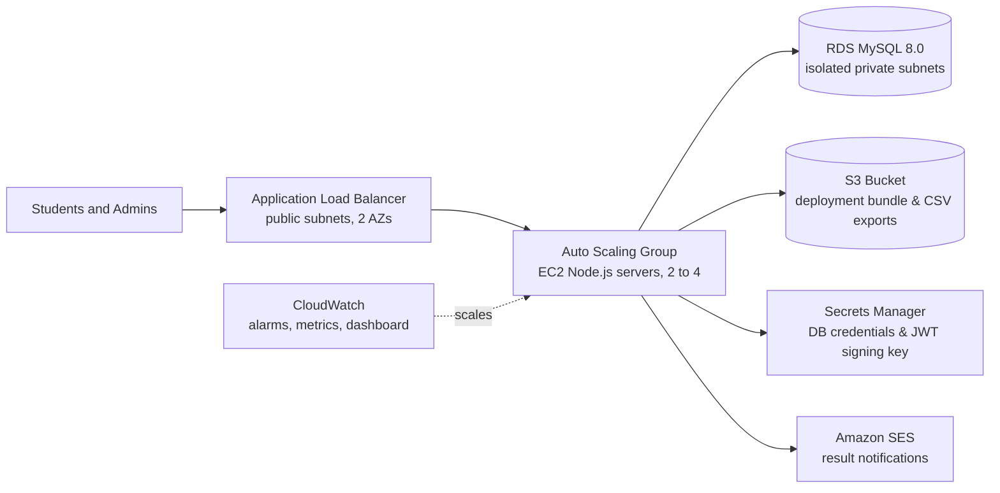

# ExamCloud: A Scalable University Examination System on AWS

FT-III Cloud Computing case study & production-grade University Examination Portal. A stateful-resilient, stateless-compute web application (Node.js + MySQL) deployed on AWS with Infrastructure as Code (Terraform): load-balanced, auto-scaling, secured, and monitored.

## 1. Problem and Requirements

On-campus exam servers crash when hundreds or thousands of students log in concurrently at the start of an examination window, sit underutilized the remainder of the year, and lack high availability and disaster recovery. ExamCloud moves the university examination authority to an elastic, resilient cloud architecture.

| Functional Requirements | Non-functional Requirements |
|---|---|
| Student registration with Roll Number, Dept & Level | Elastic Auto Scaling (2 to 4+ EC2 nodes) at exam peaks |
| Candidate ID verification screen & rule confirmation | Multi-AZ High Availability across 2 Availability Zones |
| Server-enforced timed MCQ exams with autosave & resume | Defense-in-depth: Private RDS, IAM roles, zero hardcoded secrets |
| Question navigator with mark-for-review & per-student shuffle | Pay-as-you-go cloud economics (~$50/mo idle, ~$0.02/hr scaling) |
| Tab/window switch detection and infraction telemetry | Real-time observability: CloudWatch alarms & metrics dashboard |
| Printable transcript result slip & optional answer review | Strict security: Server-side RBAC, Helmet CSP, 10m account lockout |
| Admin dashboard: SVG analytics, student roster, CSV exports | Repeatable Infrastructure as Code (Terraform) |

## 2. Cloud Architecture



**Request flow:** Browser -> Application Load Balancer (health checked via `/health`) -> EC2 Auto Scaling cluster (stateless Node.js 20 runtime) -> Private Amazon RDS MySQL. The page footer displays the instance hostname for real-time load balancing verification.

### Service Model Justification

| AWS Service | Model | Justification |
|---|---|---|
| EC2, VPC, ELB, Auto Scaling, S3 | IaaS | Granular OS, runtime, and network isolation for application security. |
| RDS MySQL, Secrets Manager, CloudWatch | PaaS | Managed database backups, patching, credential rotation, and telemetry with SLA. |
| Amazon SES | SaaS | Eliminates the overhead of maintaining dedicated SMTP mail servers. |

## 3. Project Structure

```
app/
  server.js          Express API: auth, exam lifecycle, timer enforcement, admin endpoints
  db.js              MySQL connection pool, idempotent schema migrations, seed data
  config.js          Configuration loader with AWS Secrets Manager support
  aws.js             S3 export archiving and SES notification dispatches
  public/
    index.html       Institutional layout with accessible containers
    style.css        University ink/blue design system, OMR bubbles, SVG charts, print styles
    loadtest/        Locust load test suite simulating university exam surges
infra/               Terraform IaC: VPC, subnets, ALB, ASG, RDS, S3, IAM, CloudWatch
scripts/
  deploy.ps1 / .sh   One-command cloud provisioning
  destroy.ps1 / .sh  One-command resource teardown to stop charges
  loadtest.ps1 / .sh Locust automated stress testing
docs/                Viva Voce Q&A and technical evaluation guide
docker-compose.yml   Local development container orchestration
```

## 4. Running Locally with Docker

```bash
docker compose up --build
# Open http://localhost:3000
```

### Default Seed Credentials

* **Staff Administrator**: `admin@examcloud.local` / `Admin@12345` (Roll: `ADMIN001`)
* **Demo Student**: `student@examcloud.local` or roll `2024CS001` / `Student@12345`

## 5. API Reference

### Authentication & Candidate Identity
* `POST /api/auth/register` - Student registration (`name`, `roll_no`, `email`, `department`, `year_semester`, `password`)
* `POST /api/auth/login` - Sign in by University Roll Number or Email (locks account for 10m after 5 failed attempts)
* `GET /api/profile` - Student profile and exam transcript history

### Examination Lifecycle
* `GET /api/exams` - List published examinations
* `GET /api/exams/:id` - Candidate ID verification and examination rules
* `POST /api/exams/:id/start` - Initialize or resume exam session (computes remaining time, serves shuffled questions)
* `POST /api/exams/:id/autosave` - Autosave selected answers and review flags
* `POST /api/exams/:id/tab-switch` - Record tab switch / window blur infractions
* `POST /api/exams/:id/submit` - Server-verified timer evaluation and score calculation
* `GET /api/results/slip/:examId` - Printable institutional result slip with optional answer review
* `GET /api/results/me` - Personal transcript history

### Administration & Academic Governance
* `GET /api/admin/dashboard` - Overall metrics, SVG score histogram, and per-exam submission charts
* `GET /api/admin/students` - Searchable, filterable candidate roster with pagination
* `GET /api/admin/students/:id` - Detailed candidate profile and all past submissions
* `PATCH /api/admin/students/:id/status` - Deactivate or reactivate student account
* `POST /api/admin/attempts/:id/reset` - Reset a candidate's attempt to permit a retake
* `GET /api/admin/results` - Filtered submission records (exam, department, pass/fail status)
* `GET /api/admin/results.csv` - Export grades to CSV and archive in Amazon S3
* `GET /api/admin/exams` - Comprehensive exam management
* `POST /api/admin/exams` - Create new examination (supports bulk format or structured items)
* `PUT /api/admin/exams/:id` - Update exam settings (title, pass percentage, window, publish toggle)
* `DELETE /api/admin/exams/:id` - Delete examination
* `GET /api/admin/exams/:id/analytics` - Question difficulty index and candidate option distribution
* `GET /api/admin/audit-logs` - Security audit trail of logins, exam starts, submissions, and admin actions

## 6. Security & Integrity Controls

1. **Server-Enforced Timer**: Submissions submitted after duration + 30 seconds are rejected or auto-submitted based on server timestamps (`started_at`).
2. **Brute-Force Lockout**: 5 consecutive failed login attempts lock the account for 10 minutes (`LOGIN_MAX_FAILED_ATTEMPTS`, `LOGIN_LOCKOUT_MINUTES`).
3. **Anti-Malpractice Monitoring**: Candidate tab switching or window defocusing is logged and flagged on the official transcript.
4. **Stable Shuffling**: Question and option sequences are shuffled per candidate attempt and stored stably in MySQL.
5. **Role-Based Access Control**: Strict server-side verification returns 401/403 on unauthorized requests; students cannot view or call administrative routes.
6. **Zero Hardcoded Secrets**: Production database passwords and JWT signing keys are dynamically generated and retrieved via AWS Secrets Manager.
7. **Content Security Policy**: Helmet enforces strict same-origin execution (`'self'`) with zero external CDNs or external fonts.

## 7. Cloud Deployment (AWS)

```powershell
# Deploy to AWS (approx 8-10 minutes)
.\scripts\deploy.ps1

# Teardown to eliminate billing
.\scripts\destroy.ps1
```
"# Cloud-Exam" 
